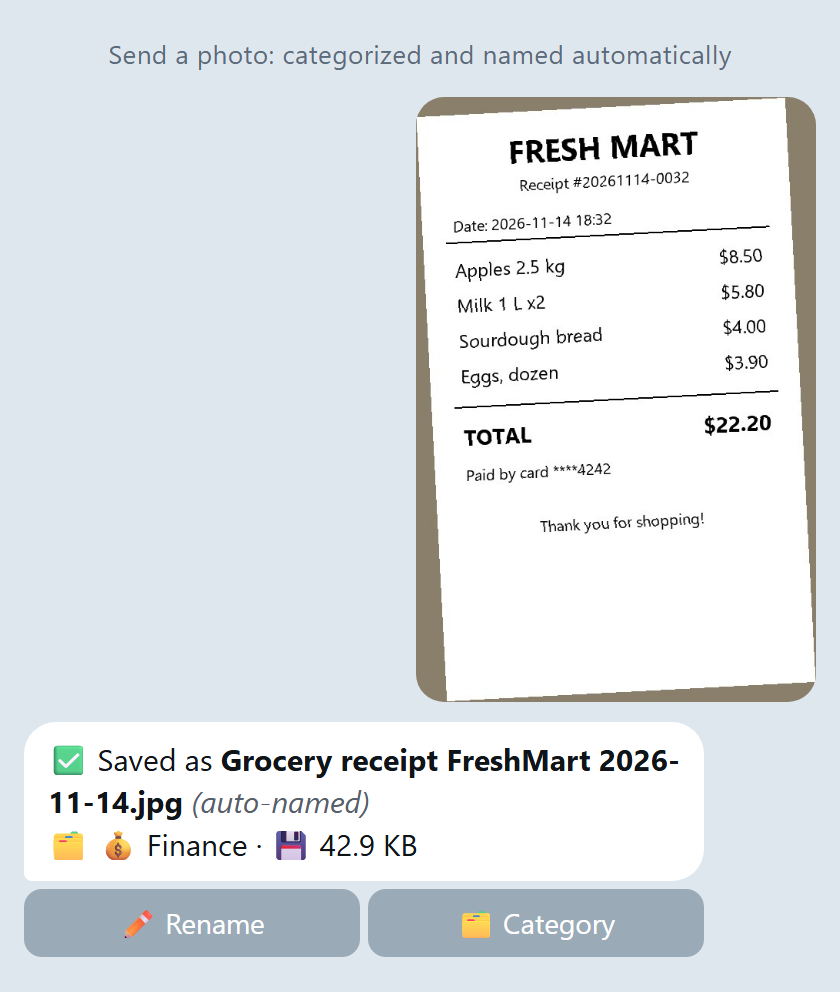
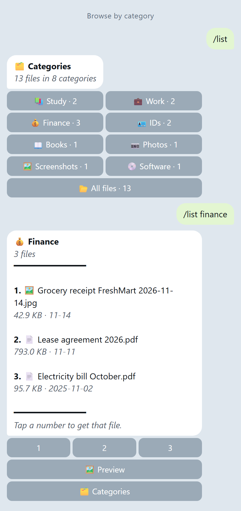
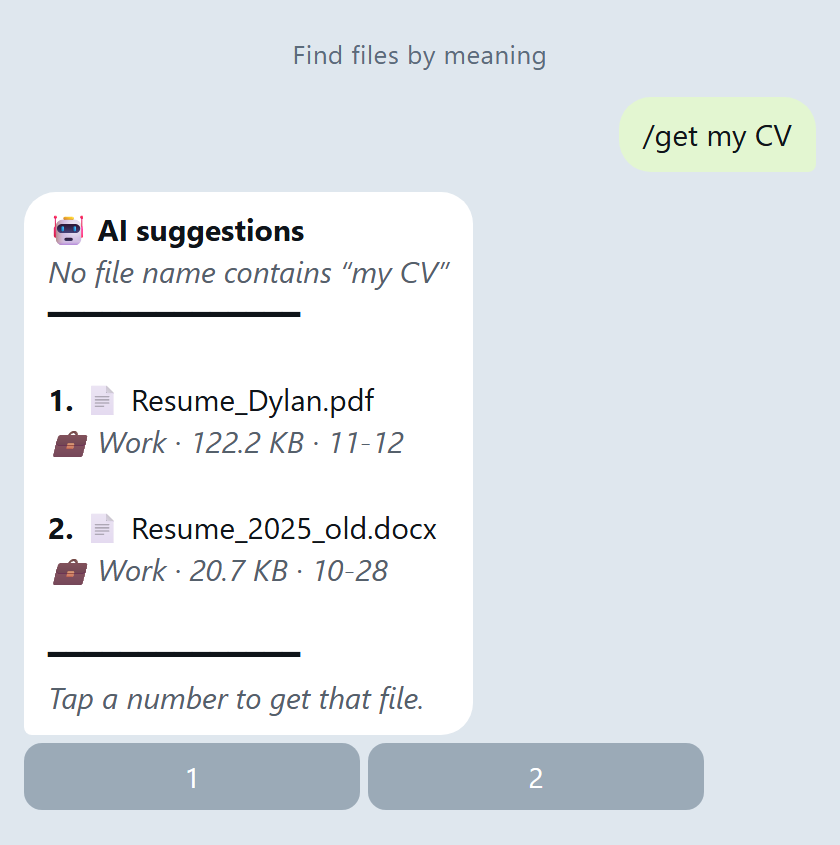
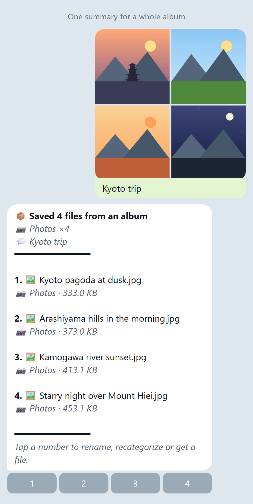

# TeleFileBot

**English** · [简体中文](README.zh-CN.md)

> A personal file storage bot for Telegram, powered by Cloudflare Workers + D1 + Workers AI. Every file is categorized and named for you. Zero cost. Zero servers.

[](LICENSE)

<table>
  <tr>
    <td align="center" valign="top" width="25%"><br><sub><b>Auto-naming</b><br>photo_123.jpg → a real name</sub></td>
    <td align="center" valign="top" width="25%"><br><sub><b>Browse by category</b><br>/list, then any category</sub></td>
    <td align="center" valign="top" width="25%"><br><sub><b>Search by meaning</b><br>/get my CV → your resumes</sub></td>
    <td align="center" valign="top" width="25%"><br><sub><b>Albums</b><br>one summary, not ten messages</sub></td>
  </tr>
</table>

<sub>Screenshots are rendered from the bot's actual message output with sample files.</sub>

---

## Features

- **Instant backup** — send any file to your bot and it's saved
- **Auto-classification** — every upload goes into one of 11 categories, decided by Workers AI from the file name, your caption and the image itself
- **Auto-naming** — meaningless names (`photo_123.jpg`, `IMG_4521.HEIC`, `Screenshot_…`) are replaced with a name that describes the content, e.g. `Grocery receipt FreshMart 2026-11-14.jpg`
- **Search by meaning** — `/get` matches names first, then lets AI find files from a description ("my CV", "visa documents")
- **Albums** — send up to 10 photos at once and get one summary; the caption applies to every photo
- **English and Chinese** — switch with `/lang`; category names and new auto-names follow the language, stored data never changes
- **Rename, recategorize, tag** — one tap under any file
- **Private** — only you can use the bot; files live in your private channel
- **Free** — runs on Cloudflare's free tier, including the AI

### Supported file types

| Type           | Examples                                       |
| -------------- | ---------------------------------------------- |
| Documents      | PDF, DOCX, ZIP, and any other file type        |
| Photos         | JPG, PNG, WebP (saved at the highest quality)  |
| Videos         | MP4, MKV, and more                             |
| Audio          | MP3, FLAC, OGG, and more                       |
| Voice messages | OGG (Telegram voice)                           |
| Video notes    | MP4 (Telegram circles)                         |
| Stickers       | WebP (static stickers)                         |
| Animations     | GIF / MP4                                      |

---

## Architecture

```
You --> Telegram Bot --> Cloudflare Worker --> D1 (metadata)
               |                 |
               |                 +---> Workers AI (category, name, search)
               +---> Private Channel (file storage)
```

Files are stored on Telegram's servers through a private channel. D1 only stores metadata (names, categories, tags, IDs). This means:

- **No storage limits** beyond Telegram's 2 GB per-file cap
- **No egress costs** — files are served directly by Telegram
- **Durable** — as long as the channel exists, your files persist

---

## Quick start

### One-step setup

```bash
git clone https://github.com/yourname/telefilebot-cloudflare.git
cd telefilebot-cloudflare
chmod +x setup.sh
./setup.sh
```

The setup script walks you through everything interactively.

### Manual setup

<details>
<summary>Click to expand manual instructions</summary>

#### Prerequisites

- [Node.js](https://nodejs.org) >= 18
- [Wrangler CLI](https://developers.cloudflare.com/workers/wrangler/install-and-update/) (`npm install -g wrangler`)
- A [Cloudflare account](https://dash.cloudflare.com/sign-up) (free tier works)
- A Telegram bot token from [@BotFather](https://t.me/BotFather)

#### Step 1: Clone and install

```bash
git clone https://github.com/yourname/telefilebot-cloudflare.git
cd telefilebot-cloudflare
npm install
```

#### Step 2: Create the D1 database

```bash
wrangler d1 create telefilebot-cloudflare-db
```

Copy the `database_id` from the output into `wrangler.jsonc`.

#### Step 3: Apply the schema

```bash
wrangler d1 execute telefilebot-cloudflare-db --file=schema.sql --remote
```

> **Upgrading an existing install?** Instead of Step 3, run the migrations your database is missing, in order:
>
> ```bash
> npm run db:migrate     # 0001: categories
> npm run db:migrate:2   # 0002: albums
> npm run db:migrate:3   # 0003: settings (language)
> ```

#### Step 4: Configure secrets

```bash
wrangler secret put BOT_TOKEN      # From @BotFather
wrangler secret put BOT_SECRET     # Any random string (secures the webhook URL)
wrangler secret put CHANNEL_ID     # Your private channel ID (e.g. -100xxxxxxxxxx)
wrangler secret put ADMIN_ID       # Your Telegram user ID
```

> **Channel ID:** add [@RawDataBot](https://t.me/RawDataBot) to your channel; it posts a message containing the ID. Remove it afterwards.
>
> **User ID:** message [@userinfobot](https://t.me/userinfobot) on Telegram.

#### Step 5: Deploy

```bash
wrangler deploy
```

#### Step 6: Register the webhook

Open this URL in your browser:

```
https://your-worker.workers.dev/registerWebhook
```

</details>

---

## Commands

Notation: `<arg>` required · `[arg]` optional · `...` repeatable

**BROWSE**

| Synopsis             | Description                                                        |
| -------------------- | ------------------------------------------------------------------ |
| `/list [<category>]` | List categories, or the files in `<category>`. A tag also works.   |
| `/all`               | List all files, newest first.                                      |
| `/get <name>`        | Send a file. Partial names work; AI searches when no name matches. |

**MANAGE**

| Synopsis                 | Description                                          |
| ------------------------ | ---------------------------------------------------- |
| `/cat <name>`            | Change a file's category.                            |
| `/rename <name> [<new>]` | Rename a file; without `<new>` the bot asks for it.  |
| `/tag <name> <tag>...`   | Add one or more tags.                                |
| `/delete <name>`         | Delete a file, after confirmation.                   |

**MAINTENANCE**

| Synopsis         | Description                                        |
| ---------------- | -------------------------------------------------- |
| `/classify`      | Categorize and name older files, 8 at a time.      |
| `/stats`         | Show storage statistics.                           |
| `/lang [en\|zh]` | Show or switch the bot's language.                 |
| `/help`          | Show help (also syncs Telegram's `/` menu).        |

**Uploading:** send any file, photo, video or audio message — it's saved, categorized and, if needed, renamed. A caption (e.g. "for the expense report") helps. Tap **✏️ Rename** or **🗂 Category** under the confirmation if the guess is wrong.

---

## How it works

### Categories

| Category        | What goes there                                         |
| --------------- | ------------------------------------------------------- |
| 📚 Study        | Course material, lecture notes, papers, homework        |
| 💼 Work         | Contracts, reports, resumes, meeting notes              |
| 💰 Finance      | Invoices, receipts, bills, taxes, bank statements       |
| 🪪 IDs          | ID cards, passports, visas, certificates, transcripts   |
| 📖 Books        | E-books, novels, comics                                 |
| 📷 Photos       | Camera photos and ordinary pictures                     |
| 🖼 Screenshots  | Screenshots, chat logs, web pages                       |
| 🎬 Media        | Movies, music, podcasts, voice messages                 |
| 💿 Software     | Installers, source code, config files                   |
| 😀 Stickers     | Stickers, memes, GIFs                                   |
| 📦 Other        | Anything else                                           |

`/list` accepts a category name in either language (`/list finance` and the Chinese name both work).

1. **Rules first, no AI call** — stickers and GIFs → Stickers, voice and video notes → Media, `.epub/.mobi/…` → Books, `.apk/.exe/.dmg/…` → Software.
2. **Otherwise Workers AI** (`@cf/google/gemma-4-26b-a4b-it`) reads the file name, MIME type, caption, forward source and a small preview image (the photo itself, an image file, or the thumbnail Telegram provides for videos and some documents).
3. **If the AI call fails**, a MIME-based guess is used, so uploads never fail because of classification.

### Auto-naming

The same AI call that picks the category also suggests a name, so naming costs nothing extra. It is only used when the original name says nothing: names generated by Telegram or this bot (`photo_…`, `video_…`, `document_…`), camera names (`IMG_`, `DSC_`, `PXL_`, …), `Screenshot_2026…`, pure numbers or hashes. Meaningful names like `Resume_Dylan.pdf` are never touched. If the model gives nothing usable, the file becomes `<category>_<date>`; clashes get a numeric suffix. `/classify` also renames older files that still have generic names.

### Search

1. Exact name (case-insensitive) → 2. name contains the text → 3. name contains every word, in any order. A single match is sent immediately.
2. Only if nothing matches by name, Workers AI reads the list of names, categories and tags and suggests up to 5 files — so `/get my CV` or `/get visa documents` work. AI suggestions are shown as a pick list, never sent automatically.

### Albums

Telegram delivers each photo of an album separately. The bot waits until the album has been quiet for 2.5 seconds, then sends **one** summary with a per-category count, the caption and a numbered list. Tap a number for that file's **⬇️ Get / ✏️ Rename / 🗂 Category** buttons. Late items update the same summary, and files you had already saved are counted as skipped.

### Language

The bot speaks English or Chinese: messages, buttons, category names, the `/` command menu, and the language the AI uses for new names.

- Set the default with the `BOT_LANG` variable in `wrangler.jsonc` (`"en"` or `"zh"`), or switch any time with `/lang`. The choice is saved in the `settings` table and overrides `BOT_LANG`.
- The database stores a fixed key for each category, so the English and Chinese names map to the same category. Switching languages never changes stored data, and existing file names stay as they are — only files named from then on use the new language.

### Cost

Workers AI includes 10,000 free Neurons per day. Classifying a file takes about 4–6 Neurons (more with a preview image), and an AI search about 9 Neurons per 40 files, growing with the number of files (capped at the 1,500 most recent). Personal use stays well inside the free allocation.

---

## Configuration

### Secrets

| Variable     | Description                                      |
| ------------ | ------------------------------------------------ |
| `BOT_TOKEN`  | Telegram bot token from @BotFather               |
| `BOT_SECRET` | Random string that secures the webhook URL       |
| `CHANNEL_ID` | Telegram channel ID for file storage             |
| `ADMIN_ID`   | Your Telegram user ID (only you can use the bot) |

### Variables (`wrangler.jsonc`)

| Variable   | Default | Description                                         |
| ---------- | ------- | --------------------------------------------------- |
| `BOT_LANG` | `en`    | Default language, `en` or `zh`. `/lang` overrides it. |

### Customization

Constants at the top of `src/index.js`:

```js
const PAGE_SIZE = 10; // Files per page
const MAX_FUZZY_RESULTS = 10; // Max results for name matching
const MAX_FILENAME_LEN = 200; // Max characters in file names
const AI_MODEL = '@cf/google/gemma-4-26b-a4b-it'; // Needs vision + chat messages
const CLASSIFY_BATCH_SIZE = 8; // Files per /classify run
const ALBUM_SETTLE_MS = 2500; // Quiet time before an album summary
const AI_SEARCH_MAX_FILES = 1500; // Files the AI search looks at
```

Categories are the `CATEGORIES` list in the same file. Each has a stored `key` (never change it once you have data), an ASCII `id` used in English prompts, display names `en` / `zh`, and descriptions the AI reads.

---

## Contributing

Contributions are welcome. Feel free to open an issue or a pull request.

---

## License

MIT — see [LICENSE](LICENSE).
