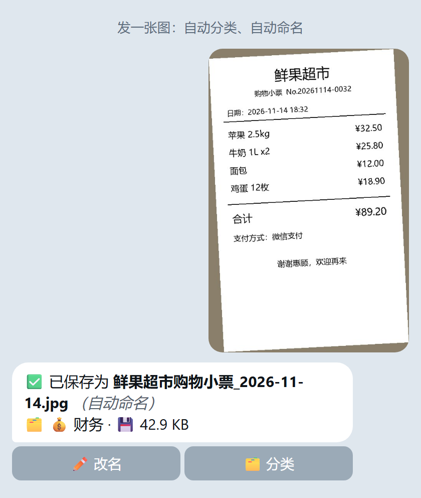
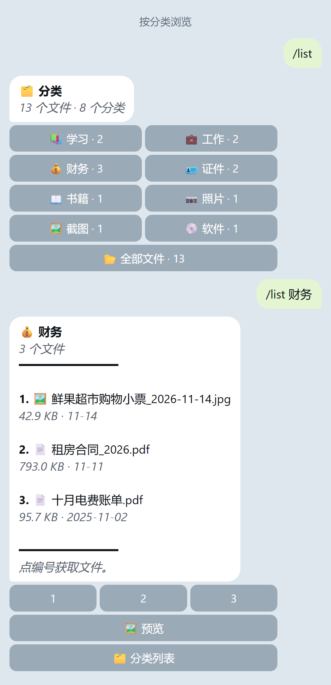
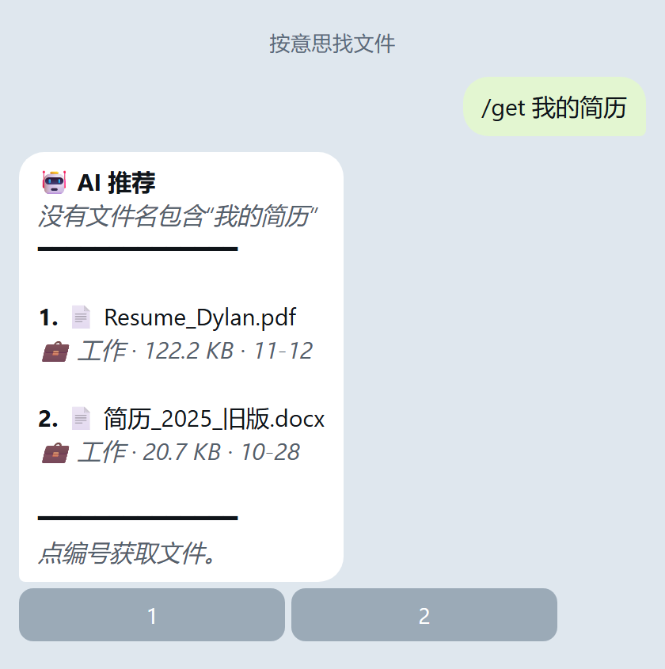
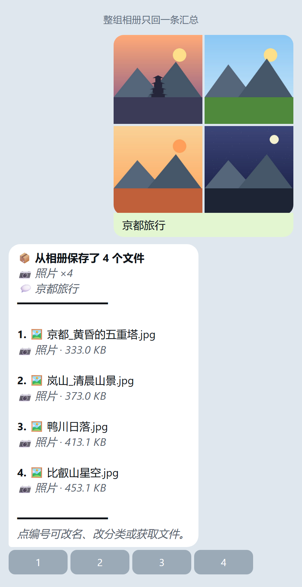

# TeleFileBot

[English](README.md) · **简体中文**

> 基于 Cloudflare Workers + D1 + Workers AI 的 Telegram 个人网盘 bot。每个文件都会自动分类、自动起名。零成本，零服务器。

[](LICENSE)

<table>
  <tr>
    <td align="center" valign="top" width="25%"><br><sub><b>自动命名</b><br>photo_123.jpg → 有意义的名字</sub></td>
    <td align="center" valign="top" width="25%"><br><sub><b>按分类浏览</b><br>/list，再打开任意分类</sub></td>
    <td align="center" valign="top" width="25%"><br><sub><b>按意思搜索</b><br>/get 我的简历 → 你的简历</sub></td>
    <td align="center" valign="top" width="25%"><br><sub><b>相册</b><br>一条汇总，而不是十条消息</sub></td>
  </tr>
</table>

<sub>截图由 bot 的真实消息输出配合示例文件渲染而成。</sub>

---

## 功能

- **即发即存**：把任何文件发给 bot 就会保存
- **自动分类**：每个文件都会归入 11 个分类之一，由 Workers AI 根据文件名、说明文字和图片内容判断
- **自动命名**：没有意义的名字（`photo_123.jpg`、`IMG_4521.HEIC`、`Screenshot_…`）会按内容改名，比如 `鲜果超市购物小票_2026-11-14.jpg`
- **按意思搜索**：`/get` 先按名字匹配，匹配不到再让 AI 根据描述找（「我的简历」「签证材料」）
- **相册**：一次发最多 10 张，只回一条汇总；说明文字对整组生效
- **中英双语**：用 `/lang` 切换；分类名和新文件的自动命名跟随语言，已存的数据不会变
- **改名、改分类、加标签**：每个文件下面点一下就行
- **私密**：只有你能用；文件存在你自己的私有频道
- **免费**：跑在 Cloudflare 免费套餐上，AI 也在免费额度内

### 支持的文件类型

| 类型 | 示例 |
| ---- | ---- |
| 文档 | PDF、DOCX、ZIP 以及其他任意格式 |
| 照片 | JPG、PNG、WebP（按最高画质保存） |
| 视频 | MP4、MKV 等 |
| 音频 | MP3、FLAC、OGG 等 |
| 语音消息 | OGG（Telegram 语音） |
| 圆形视频 | MP4（Telegram 视频消息） |
| 贴纸 | WebP（静态贴纸） |
| 动图 | GIF / MP4 |

---

## 架构

```
你 --> Telegram Bot --> Cloudflare Worker --> D1（元数据）
               |                 |
               |                 +---> Workers AI（分类、命名、搜索）
               +---> 私有频道（文件存储）
```

文件通过私有频道存在 Telegram 的服务器上，D1 只存元数据（名字、分类、标签、ID）。因此：

- **没有存储上限**，只受 Telegram 单文件 2 GB 的限制
- **没有流量费用**，文件直接由 Telegram 提供
- **可靠**，只要频道还在，文件就在

---

## 快速开始

### 一键安装

```bash
git clone https://github.com/yourname/telefilebot-cloudflare.git
cd telefilebot-cloudflare
chmod +x setup.sh
./setup.sh
```

安装脚本会一步步引导你完成配置。

### 手动安装

<details>
<summary>点击展开手动安装步骤</summary>

#### 准备

- [Node.js](https://nodejs.org) >= 18
- [Wrangler CLI](https://developers.cloudflare.com/workers/wrangler/install-and-update/)（`npm install -g wrangler`）
- 一个 [Cloudflare 账号](https://dash.cloudflare.com/sign-up)（免费套餐即可）
- 从 [@BotFather](https://t.me/BotFather) 获取的 bot token

#### 第 1 步：克隆并安装依赖

```bash
git clone https://github.com/yourname/telefilebot-cloudflare.git
cd telefilebot-cloudflare
npm install
```

#### 第 2 步：创建 D1 数据库

```bash
wrangler d1 create telefilebot-cloudflare-db
```

把输出里的 `database_id` 填进 `wrangler.jsonc`。

#### 第 3 步：建表

```bash
wrangler d1 execute telefilebot-cloudflare-db --file=schema.sql --remote
```

> **从旧版本升级？** 不用执行第 3 步，按顺序补上缺少的迁移：
>
> ```bash
> npm run db:migrate     # 0001：分类
> npm run db:migrate:2   # 0002：相册
> npm run db:migrate:3   # 0003：设置（语言）
> ```

#### 第 4 步：配置密钥

```bash
wrangler secret put BOT_TOKEN      # 从 @BotFather 获取
wrangler secret put BOT_SECRET     # 任意随机字符串（保护 webhook 地址）
wrangler secret put CHANNEL_ID     # 私有频道 ID（如 -100xxxxxxxxxx）
wrangler secret put ADMIN_ID       # 你的 Telegram 用户 ID
```

> **频道 ID**：把 [@RawDataBot](https://t.me/RawDataBot) 拉进频道，它会发一条带 ID 的消息，之后移除它即可。
>
> **用户 ID**：在 Telegram 里给 [@userinfobot](https://t.me/userinfobot) 发条消息。

#### 第 5 步：部署

```bash
wrangler deploy
```

#### 第 6 步：注册 webhook

在浏览器打开：

```
https://your-worker.workers.dev/registerWebhook
```

</details>

---

## 命令

记号：`<参数>` 必填 · `[参数]` 可选 · `...` 可重复

**浏览**

| 用法 | 说明 |
| ---- | ---- |
| `/list [<分类>]` | 列出分类，或某个分类里的文件。也可以写标签。 |
| `/all` | 列出全部文件，最新的在前。 |
| `/get <名称>` | 获取文件。可以只写一部分；名字匹配不到时由 AI 查找。 |

**管理**

| 用法 | 说明 |
| ---- | ---- |
| `/cat <名称>` | 修改文件分类。 |
| `/rename <名称> [<新名称>]` | 重命名；不写新名称时 bot 会问你。 |
| `/tag <名称> <标签>...` | 添加一个或多个标签。 |
| `/delete <名称>` | 删除文件，会先确认。 |

**维护**

| 用法 | 说明 |
| ---- | ---- |
| `/classify` | 整理旧文件的分类和名字，每次 8 个。 |
| `/stats` | 查看存储统计。 |
| `/lang [en\|zh]` | 查看或切换 bot 的语言。 |
| `/help` | 显示帮助（同时同步 Telegram 的 `/` 命令菜单）。 |

**上传**：直接发文件、照片、视频或音频，bot 会保存、分类，必要时改名。附一句说明文字（比如「报销用」）会更准。分错了就点确认消息下面的 **✏️ 改名** 或 **🗂 分类**。

---

## 工作原理

### 分类

| 分类 | 放什么 |
| ---- | ------ |
| 📚 学习 | 课程资料、讲义、论文、作业 |
| 💼 工作 | 合同、报告、简历、会议纪要 |
| 💰 财务 | 发票、收据、账单、报税、银行流水 |
| 🪪 证件 | 身份证、护照、签证、证书、成绩单 |
| 📖 书籍 | 电子书、小说、漫画 |
| 📷 照片 | 拍摄的照片和普通图片 |
| 🖼 截图 | 屏幕截图、聊天记录、网页 |
| 🎬 影音 | 电影、音乐、播客、语音 |
| 💿 软件 | 安装包、源代码、配置文件 |
| 😀 表情包 | 贴纸、梗图、GIF |
| 📦 其他 | 以上都不符合 |

`/list` 用中文或英文分类名都可以（`/list 财务` 和 `/list finance` 是同一个分类）。

1. **先按规则判断，不调用 AI**：贴纸和 GIF → 表情包，语音和圆形视频 → 影音，`.epub/.mobi/…` → 书籍，`.apk/.exe/.dmg/…` → 软件。
2. **其余交给 Workers AI**（`@cf/google/gemma-4-26b-a4b-it`）：读文件名、MIME 类型、说明文字、转发来源，以及一张小预览图（照片本身、图片文件，或 Telegram 给视频和部分文档提供的缩略图）。
3. **AI 调用失败时**按文件类型猜一个兜底，所以分类出问题也不会影响保存。

### 自动命名

起名和分类用的是同一次 AI 调用，不额外花钱。只有原名没有意义时才会用：Telegram 或 bot 生成的名字（`photo_…`、`video_…`、`document_…`）、相机名字（`IMG_`、`DSC_`、`PXL_` 等）、`Screenshot_2026…`、`微信图片_…`、纯数字或哈希。`Resume_Dylan.pdf` 这种有意义的名字不会动。AI 给不出能用的名字时，文件会被命名为 `分类_日期`；重名时自动加数字后缀。`/classify` 也会给名字没意义的旧文件改名。

### 搜索

1. 完全同名（不区分大小写）→ 2. 文件名包含这段文字 → 3. 文件名包含每个词（顺序不限）。只匹配到一个就直接发送。
2. 名字都匹配不到时，Workers AI 会根据文件名、分类和标签挑出最多 5 个文件，所以 `/get 我的简历`、`/get jianli` 都能用。AI 的结果只列出来让你点选，不会自动发送。

### 相册

Telegram 会把相册拆成单张分别推送。bot 等相册静默 2.5 秒后，只发**一条**汇总：分类统计、说明文字和带编号的文件列表。点编号会弹出该文件的 **⬇️ 获取 / ✏️ 改名 / 🗂 分类** 按钮。迟到的图片会更新同一条汇总；已经存过的文件计为跳过。

### 语言

bot 支持英文和中文，消息、按钮、分类名、`/` 命令菜单，以及 AI 给新文件起名用的语言都会跟着变。

- 默认语言用 `wrangler.jsonc` 里的 `BOT_LANG` 变量设置（`"en"` 或 `"zh"`），也可以随时用 `/lang` 切换。切换结果存在 `settings` 表里，优先于 `BOT_LANG`。
- 数据库里每个分类存的是固定的键，所以中英文名对应的是同一个分类。切换语言不会改动已存的数据，已有的文件名也保持不变，只有之后新命名的文件才用新语言。

### 费用

Workers AI 每天有 10,000 个免费 Neuron。分类一个文件约 4–6 个 Neuron（带预览图时稍多）；AI 搜索每 40 个文件约 9 个 Neuron，随文件数增长（上限是最近的 1,500 个文件）。个人使用远低于免费额度。

---

## 配置

### 密钥

| 变量 | 说明 |
| ---- | ---- |
| `BOT_TOKEN` | 从 @BotFather 获取的 bot token |
| `BOT_SECRET` | 保护 webhook 地址的随机字符串 |
| `CHANNEL_ID` | 存文件用的 Telegram 频道 ID |
| `ADMIN_ID` | 你的 Telegram 用户 ID（只有你能用这个 bot） |

### 变量（`wrangler.jsonc`）

| 变量 | 默认值 | 说明 |
| ---- | ------ | ---- |
| `BOT_LANG` | `en` | 默认语言，`en` 或 `zh`。`/lang` 的设置优先。 |

### 自定义

`src/index.js` 顶部的常量：

```js
const PAGE_SIZE = 10; // 每页文件数
const MAX_FUZZY_RESULTS = 10; // 名字匹配最多返回几个
const MAX_FILENAME_LEN = 200; // 文件名最大长度
const AI_MODEL = '@cf/google/gemma-4-26b-a4b-it'; // 需要支持看图和对话消息
const CLASSIFY_BATCH_SIZE = 8; // /classify 每次处理几个
const ALBUM_SETTLE_MS = 2500; // 相册静默多久后发汇总
const AI_SEARCH_MAX_FILES = 1500; // AI 搜索最多看多少个文件
```

分类定义在同一个文件的 `CATEGORIES` 列表里。每个分类有：存进数据库的 `key`（有数据之后不要改）、英文提示词里用的 ASCII `id`、显示名 `en` / `zh`，以及给 AI 看的说明。

---

## 参与贡献

欢迎提 issue 或 pull request。

---

## 许可证

MIT，见 [LICENSE](LICENSE)。
